## Ne bu?

Canva, 22 Ekim'de ilk kendi görsel üretim modeli **Craft**'ı duyurdu. Modeli şirketin kendi yapay zekâ laboratuvarı Canva Research sıfırdan eğitti. Craft, Canva'nın içinde ve geliştiriciler için Canva API'sinde kullanılabiliyor.

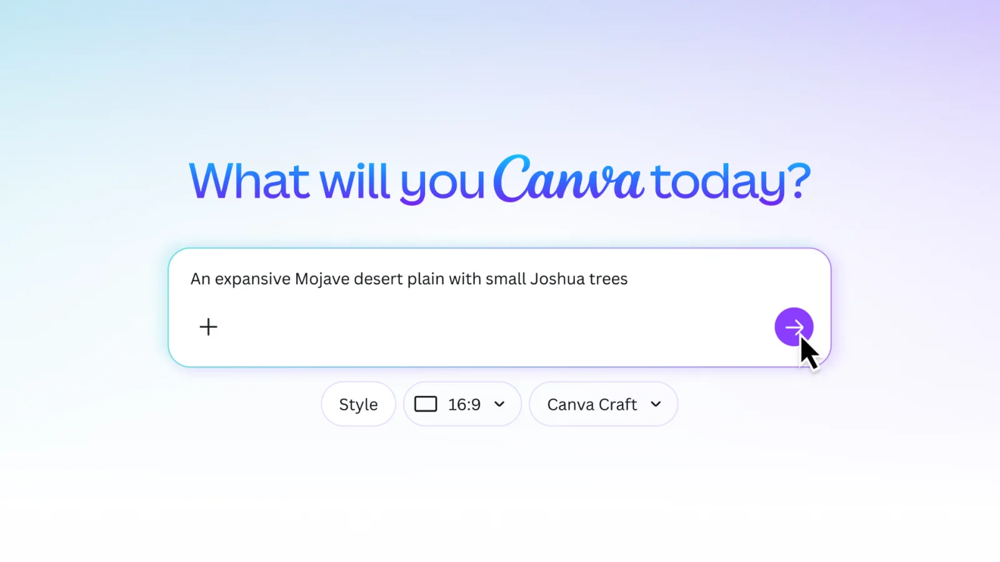

## Neyi farklı yapıyor?

- **Önce plan, sonra çizim.** Çoğu model istemden doğrudan görsel üretir. Craft iki aşamada çalışıyor: önce hangi öğenin nerede duracağını, büyüklüklerini ve görselde geçecek yazıyı planlıyor, sonra bu plana göre çiziyor.
- **Şablonlarla eğitildi.** Eğitim verisinde Canva'daki milyonlarca afiş, sosyal medya gönderisi, sunum, infografik ve menü var. Model bu sayede başlık, yazı ve boşluk dengesini daha iyi kuruyor.
- **Düzenlenebilir çıktı.** Üretilen görsel, Canva'nın Sihirli Katmanlar (Magic Layers) özelliğiyle parçalara ayrılabiliyor; yazıyı ya da bir nesneyi ayrıca taşıyıp değiştirebiliyorsunuz.
- **Dil.** İstem her dilde yazılabiliyor; Canva'ya göre görsel içinde 55 dilde yazı üretebiliyor.

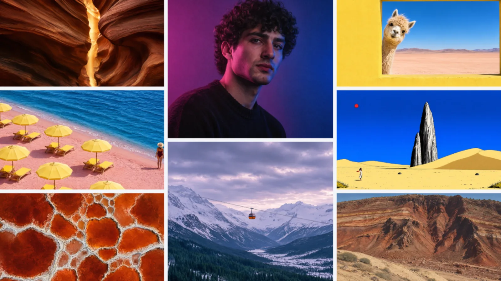

## Sıralamada nerede?

Tasarımcıların oylarıyla oluşan DesignArena sıralamasında Craft dördüncü sırada başladı. Önündeki üç model OpenAI'ın. Kategorilere göre bakınca **insan ve portre** ile **manzara ve doğa** görsellerinde birinci; soyut desenlerde ikinci, ürün görsellerinde ilk beşte. Çizgi film tarzında ise 18. sırada.

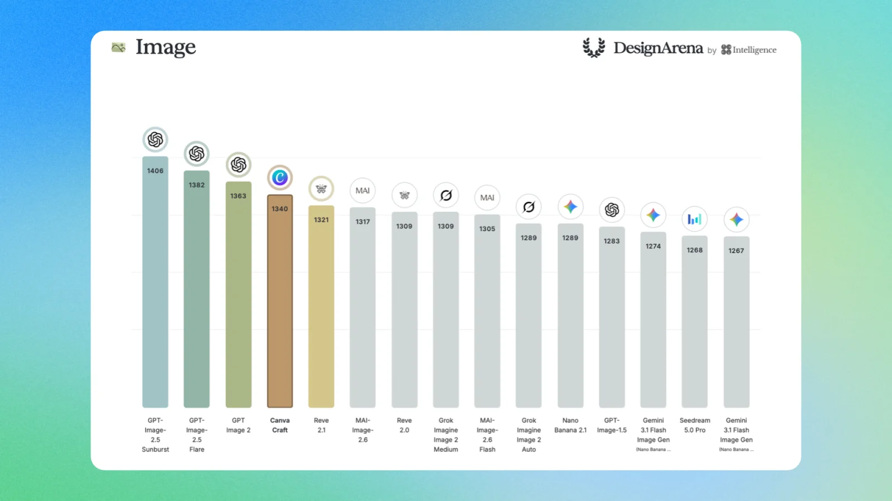

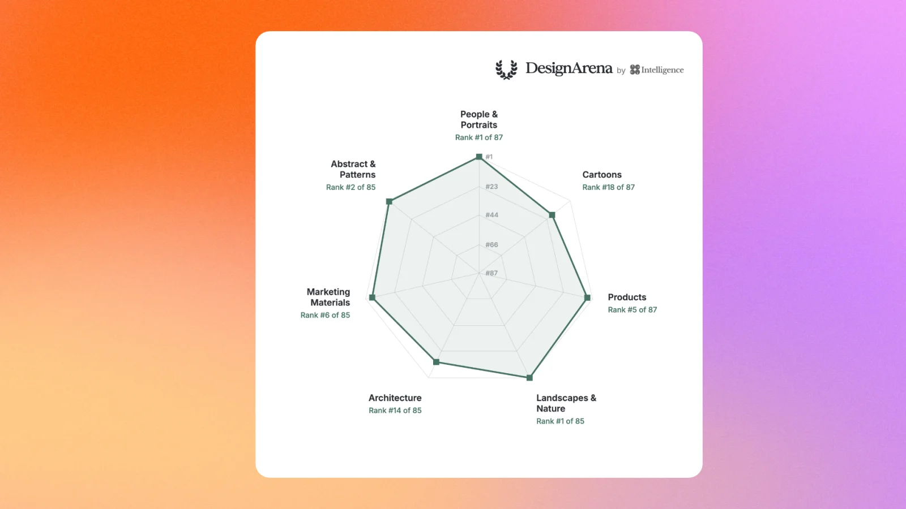

*Görseller: Canva duyurusu. Sıralama verisi DesignArena'nın, grafikler Canva'nın.*

## Öğretmen ve öğrenciler için

Millî Eğitim Bakanlığı ile Canva arasında 24 Ocak 2025'te imzalanan protokolle Canva, EBA üzerinden **tüm öğretmen, öğrenci ve okul yöneticilerinin** kullanımına açıldı. Eğitim için Canva planı ücretsiz ve premium özellikleri de içeriyor; Craft'a da bu hesapla erişiliyor.

- **Giriş:** Canva'da "Giriş yap" deyip "EBA hesabıyla devam et" seçeneğini seçin, girişi EBA ekranında tamamlayın. Öğretmenler EBA'ya MEBBİS ya da e-Devlet ile girebiliyor. E-posta adresi olmayan öğrenciler de EBA hesabıyla girebiliyor.
- **EBA ile bağlantılı:** Öğretmen Canva'da hazırladığı etkinliği EBA'ya gönderip öğrencilerine ödev olarak verebiliyor.
- **Hazır içerik ve eğitim:** Müfredata uygun hazır içerikler, ÖBA'da çevrim içi kurslar ve öğretmenlere canlı eğitimler var. Adana, Batman, Bursa, Çanakkale, Elazığ, Erzurum, Kahramanmaraş, Konya, Samsun ve Yozgat'ta Canva tasarım laboratuvarları kuruluyor.
- **Öğrenci hesaplarında:** Okul yöneticisi yapay zekâ özelliklerini kısıtlayabiliyor; öğrencilerde Dream Lab'in açık olup olmadığı okulun ayarına bağlı. ABD'de bir öğretmen, okul hesabında Craft seçeneğinin kullanılamaz göründüğünü yazdı; bizim hesabımızda ve Japonya'daki öğretmen örneğinde çalışıyor.

Eğitim hesabında Dream Lab'de model seçimi yok; seçici **Canva Craft-1 2K** olarak sabit. Kalite için Standart, Premium ve Ultra; boyut için 16:9, 9:16, 1:1, 4:3, 3:4 ve 2:1 seçenekleri var. A4 için en yakın dikey oran 3:4. Kalan kullanım hakkını gösteren bir sayaç göremedik.

## Denedik: ortaokul fen afişi

Eğitim için Canva hesabıyla, Dream Lab'de 3:4 oranında ve Premium kalitede şu istemi yazdık:

> Ortaokul fen dersi için A4 dikey sınıf afişi. Üstte büyük başlık: 'Fotosentez Nasıl Olur?'. Ortada güneş ışığı alan bir yaprağın sade, renkli illüstrasyonu; oklarla 'Güneş ışığı', 'Su', 'Karbondioksit', 'Oksijen' etiketleri. Altta tarih ve sınıf bilgisi için boş alan bırak.

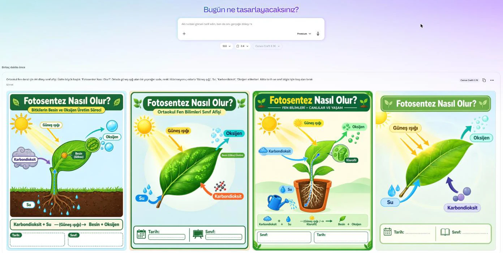

- **Süre:** Dört sonuç yaklaşık bir dakikada geldi.
- **Türkçe:** Dört görselde de başlık ve etiketler doğru; bozuk harf yok.
- **Düzen:** İstenen her şey yerinde; tarih ve sınıf alanı dördünde de boş bırakıldı.
- **Hatalar:** Bir sonuçta denklemdeki ok bozuk çıktı, "Klorofil" etiketi kloroplastı gösteriyor. İki sonuca istenmeyen "Besin (Glikoz)" etiketi eklendi.
- **Sihirli Katmanlar:** Dream Lab penceresinde yok; görseli "Editörde açın" deyip Görsel Düzenleme panelinden uygulamak gerekiyor. Yaklaşık 20 saniyede başlık düzenlenebilir bir yazıya, etiketler ve çizimler ayrı öğelere dönüştü. Tarih ve sınıf kutularındaki noktalı çizgiler kayboldu.

## İş akışı: afişten ders materyaline

1. **Dream Lab'i açın**, boyutu baştan seçin (dikey afiş için 3:4).
2. **İstemi ayrıntılı yazın:** başlığın tam metnini tırnak içinde verin; hangi öğenin nerede duracağını ve boş kalacak alanları söyleyin.
3. **Dört sonucu karşılaştırın**, yazısı ve içeriği en doğru olanı seçin. Bilgi hatası varsa yeniden üretmek yerine sonraki adımda düzeltin.
4. **Editörde açıp Sihirli Katmanlar'ı uygulayın.** Hatalı etiketi silin ya da yazısını değiştirin.
5. **Değişecek bilgileri Canva metin kutusuyla ekleyin:** tarih, sınıf, ders adı. Böylece aynı afişi her sınıf için kopyalayıp güncelleyebilirsiniz.
6. **Başka boyutlara çevirin:** "Yeniden boyutlandır" ile sunum slaytı ya da kare gönderi hâline getirin; öğretmen hesabındaysanız EBA'ya gönderin.

## Topluluktan örnek promptlar

Craft çıktığından beri öğretmenler ve tasarımcılar X'te promptlarını paylaşıyor. Aşağıdakileri Türkçeye uyarladık; bağlantılarda orijinal gönderi var. Önce İngilizce ve İspanyolca örnekler, ardından Japonya'daki öğretmenlerin ders materyalleri.

**Bağlantıdan poster.** Canva'da Craft'ı geliştiren ekibin lideri Ryan Yuan, yalnızca bir makale bağlantısı vererek bilimsel poster ürettiğini paylaştı. Bir konuyu ya da okuma metnini tek posterde özetlemek için kullanılabilir. [Orijinali: @RainbowYuhui](https://x.com/RainbowYuhui/status/2114038195914776718)

> Bu bağlantıdaki konu için 16:9 bir poster üret: [bağlantı]

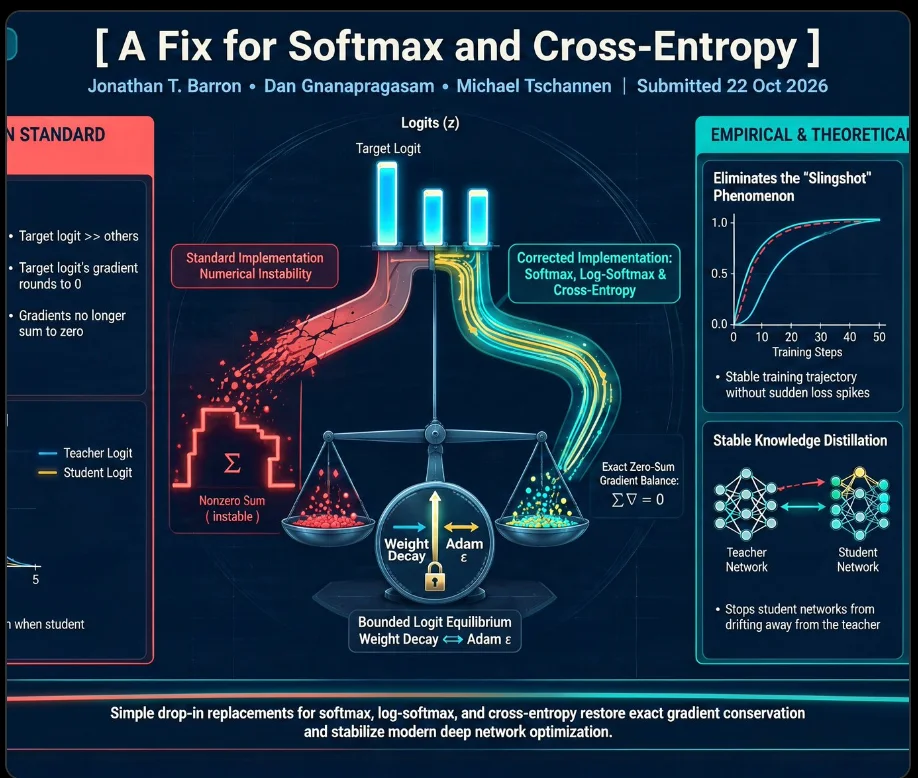

*Görsel: @RainbowYuhui (Canva), X*

**Zorlu fotogerçekçi test (İspanyolca).** İspanya'da yapay zekâ eğitimi veren bir hesap, on maddelik uzun bir istemle "İmkânsız Gerçeklikler Müzesi" sahnesini Craft ve ChatGPT'de karşılaştırdı. Yansıma, cam küre ve el anatomisi başarılı; ancak plakete istenen yazı birebir yazılmadı, satranç taşları ve dökülen kahve gibi bazı öğeler eksik kaldı. Bu testte ChatGPT daha iyi bulundu. [Orijinali: @AulasInteligent](https://x.com/AulasInteligent/status/2113609507469189323)

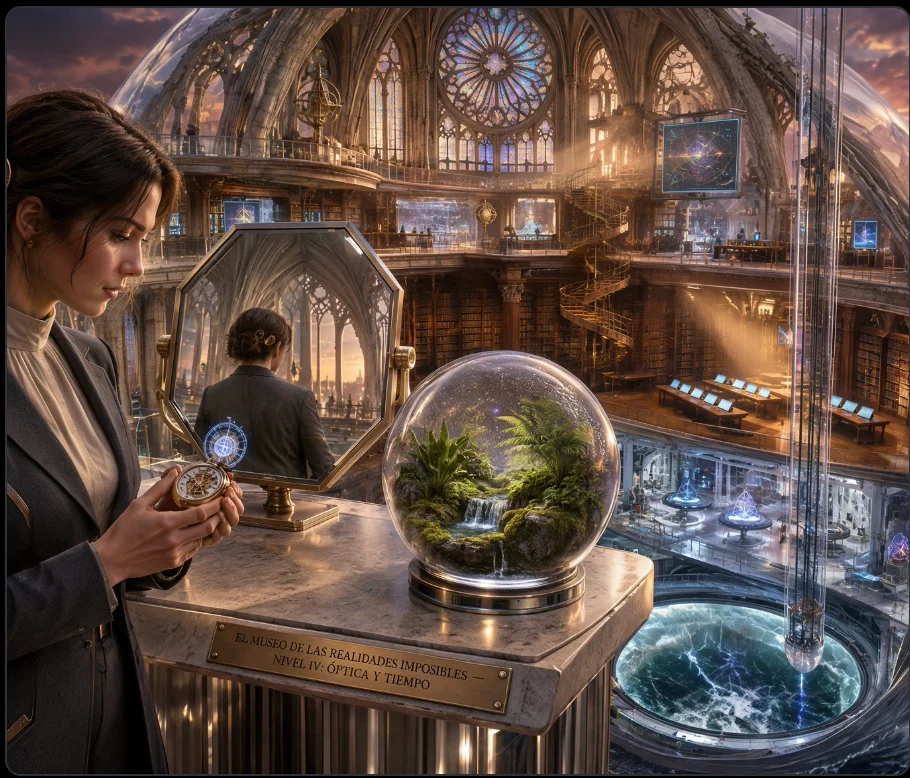

*Görsel: @AulasInteligent, X*

**Okuma ayı afişi (ilkokul).** Japonya'da bir öğretmen bir dakikada hazırladığını yazıyor; oylama kutuları doğru yerde çıkmış. [Orijinali: @DaysHakuba](https://x.com/DaysHakuba/status/2114683570250002780)

> İlkokul öğrencileri için okuma ayı etkinlik afişi. Ortada büyük başlık: "Bu ay hangisini okuyacaksın?". Sol yarıda sihirli orman ve uçan gemiyle "Macera ve fantastik dünya", sağ yarıda uzay, büyüteç ve kristallerle "Bilim ve gizem dünyası". Altta çıkartma yapıştırarak oy verilecek kutular. Sıcak suluboya ile dijital sanat karışımı bir tarz.

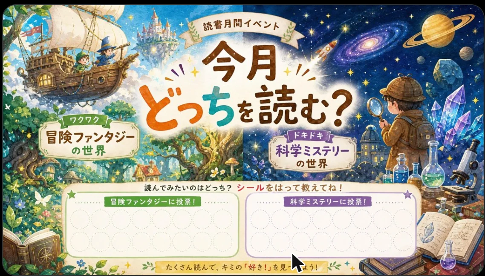

*Görsel: @DaysHakuba, X (Craft ile üretildi, Japonca)*

**Hücre karşılaştırma infografiği (ortaokul fen).** Aynı öğretmene göre dört sonucun üçünde hiç bozuk harf yok; bilimsel içeriğin yine de kontrol edilmesi gerekiyor. [Orijinali: @DaysHakuba](https://x.com/DaysHakuba/status/2114319678009131313)

> Ortaokul öğrencileri için fen bilimleri infografik afişi. Sağ ve sol olarak ikiye bölünmüş düzen. Solda yeşil tonlarda "Bitki hücresi": hücre duvarı, kloroplast ve koful üç boyutlu kesitle; sağda turuncu tonlarda "Hayvan hücresi": çekirdek, hücre zarı ve mitokondri. Ortada üstte el yazısı tarzında başlık: "Hangisi hangisi? Hücrenin yapısını karşılaştıralım". Altta benzerlikler ve farklılıklar için kontrol listesi. Bilim dergisi gibi ayrıntılı, 3B illüstrasyon tarzı.

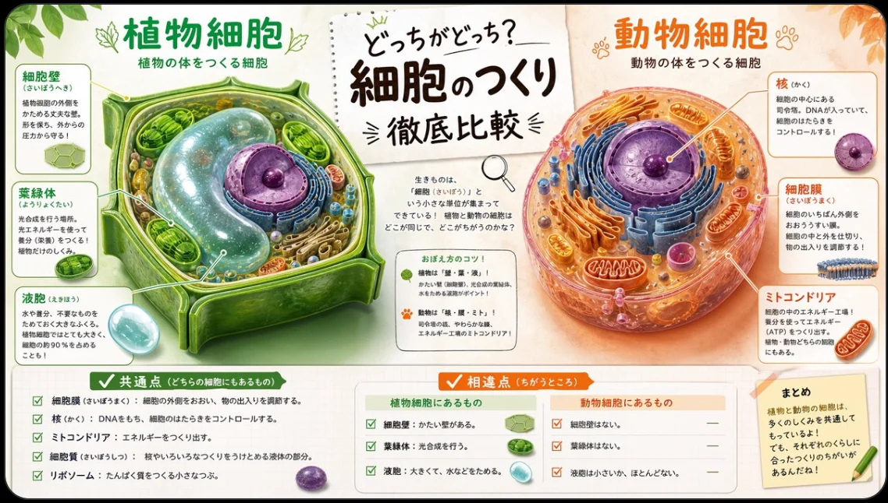

*Görsel: @DaysHakuba, X (Craft ile üretildi, Japonca)*

**Sınıfta tartışma panosu (tarih).** Üç görüşü üç sütunda karşılaştıran oylama afişi; metin ve düzen tek denemede tutmuş, tarihî kişi portreleri zayıf kalmış. [Orijinali: @DaysHakuba](https://x.com/DaysHakuba/status/2114824795582075028)

> Tarih dersi için sınıf panosu afişi. Başlık: "Sunum düellosu! Sen hangi politikaya oy verirsin?". Üç farklı yaklaşımı anlatan üç sütunlu düzen; her sütunda kısa açıklama ve bir simge. Arka planda geleneksel desen ve kâğıt dokusu, üstünde modern tipografi.

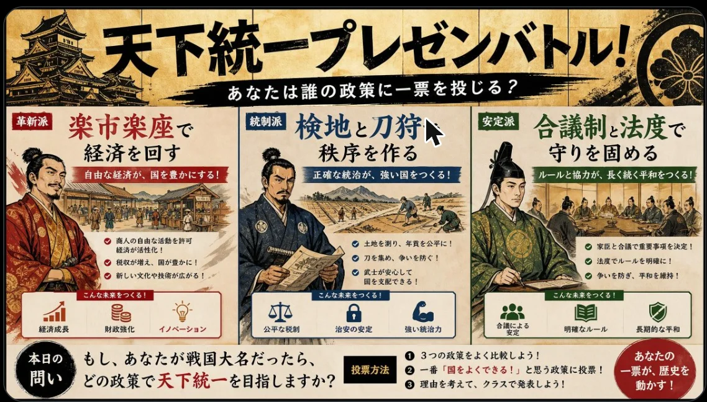

*Görsel: @DaysHakuba, X (Craft ile üretildi, Japonca)*

**Tek cümleyle seçim afişi (lise).** Eğitim için Canva hesabında, en yüksek kalitede üretilmiş; tek cümle bile düzenli bir afiş çıkarmış, görselde birkaç uydurma ayrıntı var. [Orijinali: @DaysHakuba](https://x.com/DaysHakuba/status/2113984305026527354)

> Lise öğrencilerinin iki okul gezisi arasında seçim yapması için afiş: Kapadokya mı, Ege kıyıları mı?

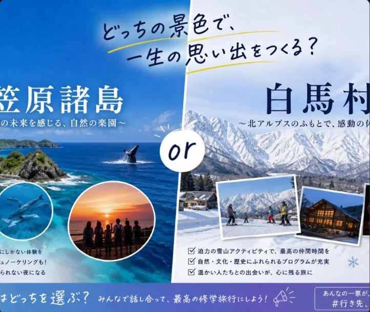

*Görsel: @DaysHakuba, X. Orijinal istem iki Japon bölgesini karşılaştırıyor.*

**Kısa istem, sonra katmanlar.** Bir tasarımcı tek satırlık "donut dükkanı için açılış el ilanı yap" istemiyle düzenli bir ilan aldı; sonra Sihirli Katmanlar ile ayırıp yazı tiplerini ve boşlukları elle düzeltti. Ayırınca yazı tiplerinin değiştiğini de not ediyor. [Orijinali: @revolvtech](https://x.com/revolvtech/status/2114651985425174688)

**Topluluktan ipuçları**

- Tarih, saat, fiyat gibi kesin bilgileri görsele yazdırmayın; sonradan Canva metin kutusuyla ekleyin.
- Görselde olmasını istediğiniz her şeyi açıkça yazın; modelin tahmin etmesine bırakmayın.
- Çok uzun promptlar kısaltılabiliyor; bir kullanıcı karakter sınırının sıkı olduğunu yazıyor. Başka bir araç için yazılmış uzun promptları olduğu gibi yapıştırmayın.

## Asistanlardan kullanmak

Canva'nın yapay zekâ bağlayıcısı (Canva MCP) Claude ve ChatGPT'ye bağlanabiliyor; Eğitim için Canva hesapları da kullanabiliyor. Bağlayıcı sohbetten tasarım ve görsel üretebiliyor, ancak bunu Craft ile yapıp yapmadığını Canva açıklamıyor. Craft duyurusunda MCP desteği "yakında" olarak geçiyor.

## Dikkat edilecekler

- **İçeriği kontrol edin.** Tasarım ve yazım güçlü, bilgi doğruluğu değil. Ders materyalinde etiketleri, okları ve formülleri tek tek gözden geçirin.
- **İnce yazı ve teknik çizim zayıf.** Canva da küçük puntolu metinlerin ve teknik çizimlerin henüz iyi olmadığını söylüyor.
- **Referans görsel yok.** Aynı karakteri ya da ürünü birden fazla görselde sabit tutmak için kendi görselinizi veremiyorsunuz; Canva bu özelliğin sonra geleceğini söylüyor.
- **Kullanım hakkı sınırlı.** Ücretsiz planda ayda yaklaşık 20 yapay zekâ kullanımı var; Canva tek bir Craft görselinin bu haktan ne kadar düşürdüğünü açıklamadı.
