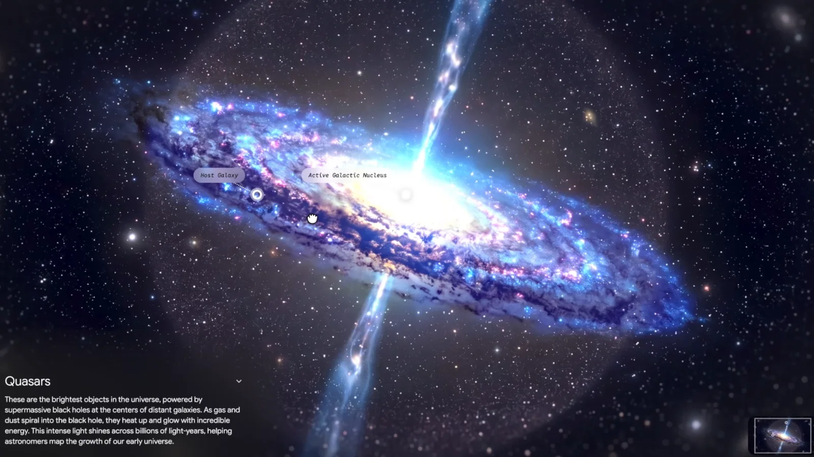
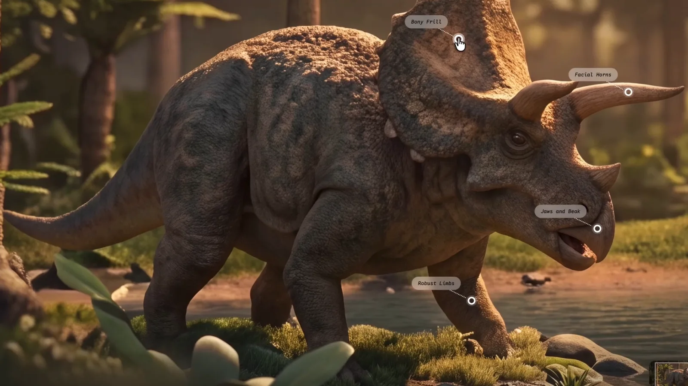
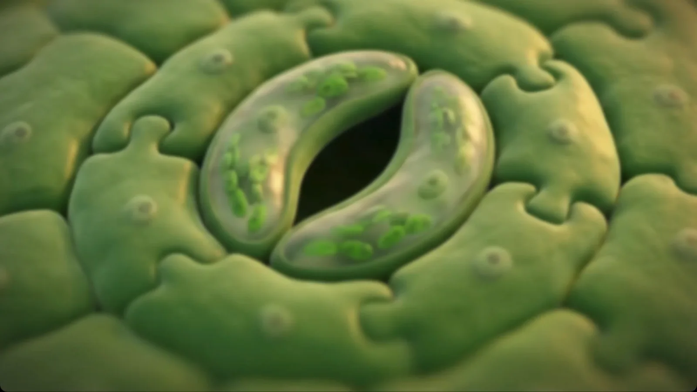
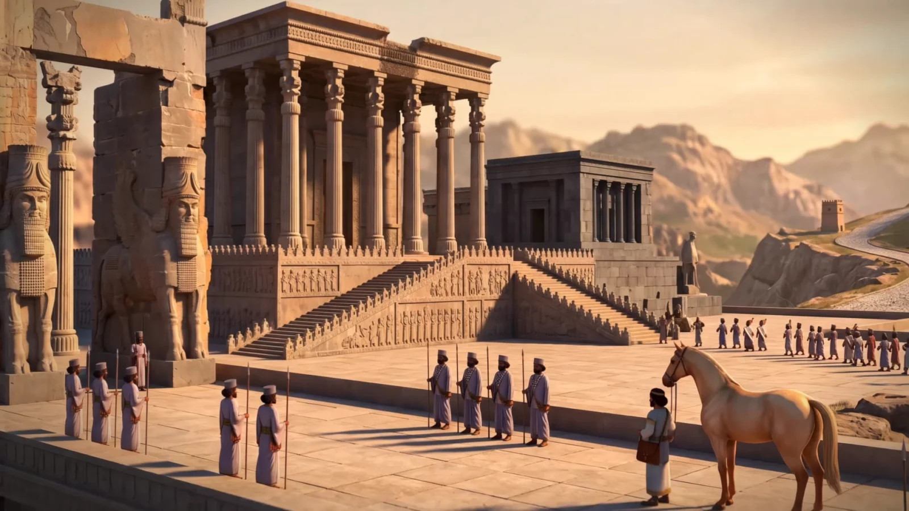

## Ne bu?

Google, 28 Ekim'de Gemini uygulamasına "immersive explorations" adını verdiği bir görsel keşif kütüphanesi ekledi. Uygulamada "Immersive View" başlığıyla, beta etiketiyle görünüyor.

Kütüphanede hazır konular var: Persepolis ve Pers İmparatorluğu, İpek Yolu, yıldırımın fiziği, kuasarlar, jet motorunun içi, MR cihazının içi, parfüm, şehir su sistemi, dinozorlar ve daha fazlası. Konular Tarih, Nasıl Çalışır, İnsan Vücudu, Doğa ve Uzay sekmelerine ayrılmış.

## Nasıl çalışıyor?

- **Sahneyle açılıyor.** Her konu belgesel kalitesinde tek bir büyük görselle başlıyor.
- **Etikete dokunup içeri giriyorsunuz.** Sahnedeki etiketler bir parçayı işaret ediyor. Dokununca o bölgeye yakınlaşılıyor ve yeni bir sahne açılıyor; yakınlaşılan yer çerçeveyle gösteriliyor.
- **Her katmanda kısa bir açıklama var.** Sol altta birkaç cümlelik bir metin çıkıyor.


- **Bazı konular çok derine iniyor.** Örneğin kuasardan galaksiye, toz bantlarına ve yıldız oluşum bölgelerine; bir bitkiden yaprağa ve gözeneklere iniliyor. Google'a göre bazı yolculuklar molekül ve atom ölçeğine kadar gidiyor.







*Görseller: Google tanıtım videosundan kareler.*

## Nasıl açılır?

Gemini'de öğrenci bölümündeki "Try immersive explorations" düğmesinden ya da doğrudan aşağıdaki adresten açılıyor. Öğrenci olmanız gerekmiyor; Google hesabıyla giriş yapmak yeterli ve ücretsiz.

```
gemini.google.com/immersive-explorations
```

Google iki şeyin "yakında" geleceğini söylüyor: her katmanı anlatan sesli anlatım ve keşiflerin doğrudan sohbetin içinden açılması. İkisinin de tarihi verilmedi.

## Dikkat edilecekler

- **İçerik şimdilik İngilizce.** Menüler Türkçe görünse de sahnelerdeki etiketler ve açıklamalar İngilizce. Google daha fazla dilin geleceğini söylüyor.
- **Görseller büyük olasılıkla yapay zekâ üretimi.** Google hangi modelin kullanıldığını açıklamadı. Sahneler gerçek fotoğraf değil, temsili canlandırma; ayrıntıları bilimsel ya da tarihsel kaynak gibi kullanmayın.
- **Konu sayısı az, kendi konunuzu açamıyorsunuz.** Şimdilik yalnız hazır kütüphanedeki sınırlı sayıda konu var.
- **Beta.** Özellik ilk kez 7 Eylül'de duyurusuz olarak görüldü, bugün resmen açıldı; görünümü ve konu listesi değişebilir.
