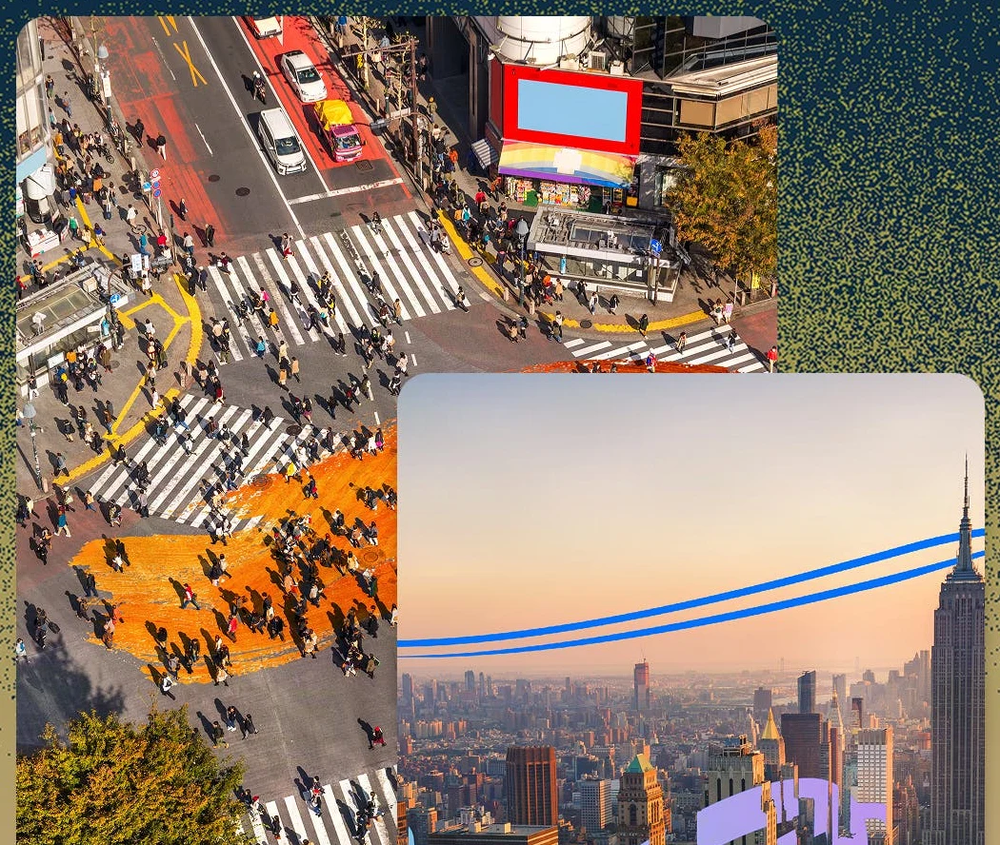

## Kısaca

Adobe'nin yıllık yaratıcılık konferansı MAX bu yıl 10–12 Kasım'da Miami Beach'te yapıldı. İlk gün ürün duyuruları, ikinci gün Adobe Labs'in deneysel projelerini gösterdiği Sneaks oturumu vardı. Duyuruların ortak noktası iki tane: yapay zekâ asistanlarının uygulamaların içine yayılması ve Adobe dışındaki modellerin (Google, Kling, OpenAI, Runway, Luma ve diğerleri) Adobe araçlarında seçilebilmesi.

Aşağıdaki tabloda her yeniliğin nerede olduğunu ve bugünkü durumunu Adobe'nin kendi yazılarına göre topladık. "Sürümde" bugün normal uygulamada var demek; "beta" ayrı beta uygulamasında ya da açık denemede; "önizleme" ise henüz kullanıcıya açık değil.

## Ne, nerede, durum

| Yenilik | Nerede | Durum |
|---|---|---|
| Color Mode (renk düzenleme alanı) | Premiere | Genel kullanımda |
| Generative Remove (videodan nesne silme) | Premiere (beta) | Beta |
| Generative Media (video, ses efekti, ortam sesi, müzik üretimi) | Premiere | Adobe durum belirtmedi |
| Enhance Audio, Separate Crosstalk, Separate Sound Source | Premiere | Adobe durum belirtmedi |
| Relight (yeniden ışıklandırma) | Photoshop 28.0 | Sürümde |
| Generative Restyle (stil değişikliği, ayarlanabilir katman) | Photoshop 28.0 | Sürümde |
| Remove aracı: gölge ve yansımayı da silme, Quick Compare | Photoshop 28.0 | Sürümde |
| Mockups, Camera Angles, Generative Recompose, Convert to Text Layers | Photoshop (beta) | Beta |
| Open Eyes (kapalı gözü açma) | Lightroom | Açık beta |
| Co-editing (aynı sayfada birlikte çalışma) | InDesign | Açık beta |
| AI Assistant (çok adımlı işleri yapan asistan) | Premiere, Illustrator, InDesign, After Effects, Frame.io | Beta |
| Plan Mode ve Model Selector | Firefly AI Assistant | Beta |
| Firefly Design (tek tuvalde tasarım) | Firefly | Beta |
| Firefly Graph (tekrar kullanılabilir iş akışları) | Firefly | Beta |
| Firefly Builder (fikirden prototip site/uygulama) | Firefly | Kapalı beta |
| Sürekli çalışan ajanlar | Firefly | Önizleme |
| MCP bağlantısı | Photoshop, Illustrator, Premiere, After Effects | Önizleme; kullanıcılara 2027 başında |
| Deep Brush, Hands On | Adobe Labs Playground | Araştırma önizlemesi |

## Video kurgusu yapanlar için: Premiere

- **Color Mode genel kullanımda.** Nisan'da beta olarak gelen renk düzenleme alanı artık Premiere'in normal sürümünde. Adobe onu "hızlı düzeltmeden ileri seviye renk düzenlemeye kadar" video kurgucuları için tasarlanmış bir alan olarak tanımlıyor.
- **Generative Remove (beta).** Silmek istediğiniz nesneyi maskeleyip izliyorsunuz (boom mikrofonu, logo gibi), Remove'a basıyorsunuz; Premiere yalnızca maskenin içini dolduruyor, dışı değişmiyor. Adobe topluluk duyurusuna göre şimdilik 480p–1080p SDR, en çok 30 fps ve en çok 10 saniyelik kliplerde çalışıyor; işlem bulutta yapılıyor ve internet gerekiyor. Bir Adobe yetkilisinin yanıtına göre saniyesi 40 üretken kredi; yani 10 saniyelik bir klip 400 kredi. Adobe, kesik kesik değil tüm klibi tek seferde işlemeyi öneriyor; yoksa parçalar arasında dolgu tutmayabiliyor.
- **Generative Media.** Zaman çizelgesinde, kurgunun bağlamına bakarak b-roll, müzik, ses efekti ve ortam sesi üretiyor. Firefly'ın yanında Google, Kling, Runway ve Luma modellerini kullanıyor. Adobe bu özellik için MAX yazısında beta ya da sürüm bilgisi vermedi.
- **Ses ayırma.** Enhance Audio konuşmayı, müziği, ortamı ve efektleri ayrı kanallara ayırıyor; Separate Crosstalk üst üste konuşan kişileri ayrı izlere bölüyor; Separate Sound Source gürültülü diyaloğu temizliyor. Röportaj ve sokak çekimi yapanlar için en pratik kısım bu olabilir.
- **AI Assistant.** Premiere, After Effects ve Frame.io'da çok adımlı işleri sözle tarif ettiğinizde yapan asistan genişledi; hâlâ beta.

## Fotoğraf ve kapak hazırlayanlar için: Photoshop ve Lightroom

Photoshop 28.0, 10 Kasım'da yayınlandı.

- **Relight.** Görseldeki mevcut ışığı algılıyor; üç taneye kadar yeni ışık kaynağı ekleyip konumunu, rengini, şiddetini ve yumuşaklığını ayarlıyorsunuz. Sonuç ayrı bir katmanda, asıl görsel bozulmuyor. CG Channel'a göre her üretim 30 üretken kredi.
- **Generative Restyle.** Yazıyla istediğiniz bir stil değişikliğini ayrı bir katmana koyuyor ve etkinin yoğunluğunu kaydırıcıyla ayarlamanızı sağlıyor; tekrar tekrar prompt yazmanız gerekmiyor. CG Channel'a göre her özel kaydırıcı 80 kredi.
- **Remove aracı** artık silinen nesnenin gölgesini, yansımasını ve ayak izi gibi izlerini de algılıyor. **Quick Compare** ise öncesini ve sonrasını tuval üzerinde kaydırmalı bölünmüş ekranda gösteriyor.
- **Beta uygulamasında:** Mockups (bir tasarımı bir nesnenin yüzeyine yerleştirme), Camera Angles (görsele yeni bakış açıları), Generative Recompose (görseli kompozisyonu koruyarak başka en-boy oranına taşıma), Convert to Text Layers (düz görseldeki yazıyı düzenlenebilir yazı katmanına çevirme), Timelapse ve sadece pus, parlama gibi atmosfer etkilerini silen Remove Ambient Effect Only. CG Channel'a göre Generative Recompose sürüm notlarında yanlışlıkla geçmiş; yalnızca beta uygulamasında.
- **Lightroom:** Open Eyes kapalı gözü kitaplığınızdaki başka bir fotoğrafı referans alarak açıyor (açık beta). Ayrıca yumuşak ışık etkisi veren Glow eklendi, mobildeki leke temizleme de masaüstü Lightroom'a geldi.

## Firefly ve asistanlar

- **Firefly AI Assistant** artık Adobe Creative Agent adını verdiği altyapıyla çalışıyor; Plan Mode ve Model Selector eklendi (beta). Model Selector ile işin hangi modelle yapılacağını kendiniz seçebiliyorsunuz; seçmezseniz asistan Adobe ve ortak modeller arasında kendisi seçiyor.
- **Firefly Design (beta).** Piksel görsel, vektör, hareket, 3D ve baskı işini tek tuvalde birleştiriyor; müşteri onayı ve dışa aktarma da aynı yerde.
- **Firefly Graph (beta)** sık yaptığınız bir işi, birden fazla model ve Adobe aracını birleştiren tekrar kullanılabilir bir akışa çeviriyor. **Firefly Builder (kapalı beta)** yazdığınız bir fikirden kodsuz site, sunum ya da uygulama prototipi çıkarıyor.
- **Sürekli çalışan ajanlar (önizleme)** dosya düzenleme, kalite kontrolü ve içeriği kanallara hazırlama gibi tekrar eden işleri arka planda yapacak.
- **Ortak modeller.** Firefly'da Adobe'nin modellerinin yanında Topaz Labs, ByteDance, Google, Kling, OpenAI ve ElevenLabs modelleri var. Topaz'ın büyütme ve keskinleştirme modelleri (Wonder 4, Image HDR) Creative Cloud'a da geliyor.

## MCP: kendi asistanınızla Adobe uygulamalarını kullanmak

MCP, Claude ya da ChatGPT gibi bir yapay zekâ asistanının bir programı doğrudan kullanmasını sağlayan bağlantı standardı. Adobe; Photoshop, Illustrator, Premiere ve After Effects için yerel MCP bağlantısını önizleme olarak gösterdi. Amaç, sevdiğiniz asistanın bilgisayarınızdaki proje dosyalarını açıp düzenleyebilmesi; katmanlar, sekanslar ve kompozisyonlar düzenlenebilir kalıyor. Adobe'ye göre kullanıcılara 2027 başında açılacak. Ayrıca Anthropic ve OpenAI asistanları için Adobe bağlayıcıları hazır olduğu belirtildi.

## Sneaks: 10 deneysel proje

Sneaks, Adobe araştırmacılarının henüz ürün olmayan fikirlerini gösterdiği oturum; bu yıl oyuncu Terry Crews sundu. Adobe bu projelerin gelecekteki araçlara yön vereceğini söylüyor ama hiçbirinin ürüne dönüşeceğine söz vermiyor. Açıklamalar Adobe Labs'teki proje sayfalarından:

- **Scene Sweep:** Tek bir prompt ya da düzenlenmiş tek bir kareyle uzun, çok planlı bir videoda değişikliği tüm planlara, kesmelere ve kamera açılarına tutarlı biçimde uyguluyor (kıyafet değiştirme, logo silme gibi).
- **Screen Test:** Bir karaktere yüz, ses ve kişilik verip onunla konuşuyorsunuz; konuşmadan çıkan kişilik profili video üretimini yönlendiriyor.
- **Live Set:** Video üretilirken akışı izliyorsunuz; oynarken promptu, nesneyi, kıyafeti ya da kamera hareketini değiştirebiliyorsunuz.
- **On Cue:** Üretilen videoda bir hareketin, parlamanın ya da sesin tam ne zaman olacağını, elle çizilen ya da müzikten çıkarılan bir zamanlama eğrisiyle belirliyor.
- **Sound Bender:** Bitmiş bir miksten bir sesi yazıyla tarif ederek ayırıyor, sonra bu sesin çeşitlemelerini etkileşimli bir tuvalde şekillendiriyor.
- **Deep Brush:** Görüntüdeki biçimi, rengi ve ışığı anlayan bir fırça. Boya yüzeyin kıvrımını izliyor, rengi değiştirirken gölgeler kalıyor, sahneye ışık boyayabiliyorsunuz.
- **Sight Span:** Tek bir görseli içinde gezilebilen bir ortama çeviriyor; karenin dışına çıkıp yeni açılar bulabiliyor, yeni görsel ya da kamera hareketli video alabiliyorsunuz.
- **Hands On:** Görseli inceleyip tuvalin üzerine doğrudan tutma noktaları koyuyor; örneğin bir kupanın kulpunu prompt yazmak yerine sürükleyerek yeniden biçimlendiriyorsunuz.
- **Rinse Repeat:** Photoshop'ta yaptığınız bir düzenlemeyi kopyalayıp başka yerlere, oraya uyarlayarak yapıştırıyor; düzenleme Photoshop'un kendi araçlarıyla kurulduğu için değiştirilebilir kalıyor.
- **Link Up:** Bir nesneyi sürüklerken sürükleme yönünü ve hızını da girdi sayıyor; nesne sahnenin perspektifine, ölçeğine ve stiline uyuyor, sonuç düzenlenebilir vektör olarak kalıyor.

*Görsel: Adobe Labs, Project Deep Brush*

### Şimdi deneyebilecekleriniz

**Deep Brush** ve **Hands On**, [Adobe Labs Playground](https://labs.adobe.com/playground/)'da araştırma önizlemesi olarak açık. Aynı sayfada Sneaks'te gösterilmeyen **Custom Filters** da var; Adobe bunu Photoshop için araştırdığı bir yetenek olarak tanımlıyor. Screen Test ve Sound Bender'a benzeyen iki deney "yakında" olarak listelenmiş. Oturumun tamamı (yaklaşık 1 saat 40 dakika) [Adobe'nin YouTube kanalında](https://www.youtube.com/watch?v=a1Y0CyVpyoI).

## Diğer duyurular

- **Google:** Google'ın en yeni görsel ve video modelleri Firefly, Photoshop, Adobe Express ve Premiere'e geliyor; Acrobat Google Workspace'e geliyor. Tarih verilmedi.
- **Microsoft:** Photoshop, Premiere ve After Effects, Arm işlemcili Windows bilgisayarlar için optimize edildi.
- **Disney:** Adobe, çok yıllık bir anlaşmayla Disney'in "resmî yapay zekâ inovasyon ortağı" oldu.
- **Kurumsal:** GenStudio tarafında kampanya planlayan ajanlar ve markanın kurallarını uygulayan Brand Intelligence duyuruldu.

## Dikkat edilecekler

- **Kredi.** Relight, Restyle, Generative Remove ve Generative Media üretken kredi harcıyor. Tek uygulamalı Photoshop aboneliğinde ayda 25 üretken kredi var (CG Channel); Relight'ı birkaç kez denemek bile bunu bitirebilir.
- **Beta ile sürümü karıştırmayın.** Generative Remove, Mockups ve Generative Recompose ayrı beta uygulamasında. Müşteri işinde kullanmadan önce bir kopya projede deneyin.
- **Sneaks ürün değil.** Deep Brush ve Hands On'u deneyebiliyorsunuz, ama Adobe bunların ürüne gireceğine dair bir taahhütte bulunmuyor.
- **Erişim.** Labs Playground'un ve yeni beta özelliklerinin Türkiye'den ve hangi planlarla açıldığını henüz kontrol etmedik.
