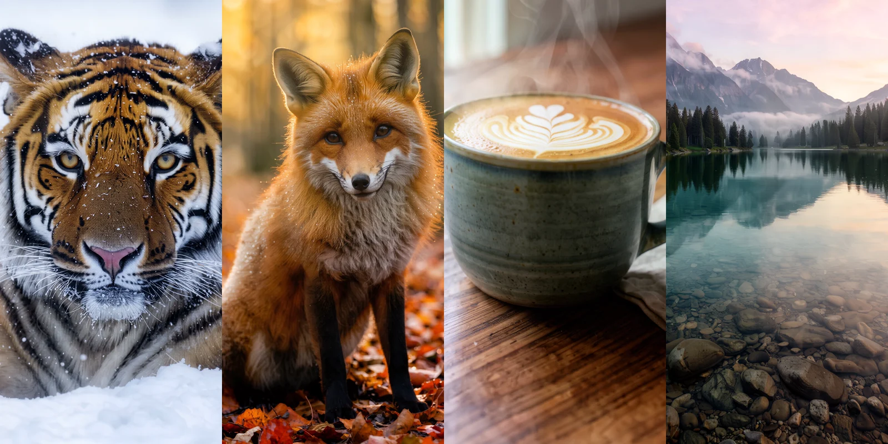

## Ne bu?

[FLUX 3 Image Klein](/gundem/2026/10/flux-3-image-klein/), Black Forest Labs'in 15 Ekim 2026'da ağırlıklarını açtığı görsel modeli. Doğrudan 4K üretiyor, kısa yazıları (tabela, logo) düzgün basıyor. Dosyaları bir kez indirdikten sonra her şey bilgisayarınızda çalışıyor: kredi yok, kullanım sınırı yok, görselleriniz bir sunucuya gitmiyor. Yıllık geliri 5 milyon doların altındaki kişi ve şirketler ticari olarak da ücretsiz kullanabiliyor; lisans metnini indirirken okuyun.

Bu sayfadaki her adımı kendimiz uyguladık. Instagram videomuzdaki bütün görseller bu kurulumla üretildi.

## Ne gerekiyor?

| | NVIDIA ekran kartlı PC | Apple Silicon Mac |
|---|---|---|
| Sürüm | INT8 | bf16 |
| İndirme | ~11 GB | ~20 GB |
| Bellek | 8 GB VRAM yeterli (Black Forest Labs) | Model ~20 GB; 32 GB ve üstü birleşik bellek gerekir |
| İş akışı dosyası | `flux3_klein_int8_t2i.json` | `flux3_klein_bf16_t2i.json` |

- Mac'te INT8 sürümü çalışmıyor; bf16 kullanın.
- Bir de Hugging Face hesabı gerekiyor (ücretsiz). Kurulum ve indirme için internet lazım; sonrasında üretim çevrimdışı çalışır.

## Kurulum: 5 adım

### 1. ComfyUI'yi kurun

[comfy.org/download](https://www.comfy.org/download) adresinden masaüstü sürümünü indirip kurun (Windows ve Mac). Zaten kuruluysa güncelleyin: FLUX 3 Klein desteği yeni sürümlerde var.

### 2. Lisans formunu onaylayın

[huggingface.co/black-forest-labs/flux-3-image-klein-comfy](https://huggingface.co/black-forest-labs/flux-3-image-klein-comfy) sayfasına Hugging Face hesabınızla girin, kısa lisans formunu doldurun. Bizde erişim hemen açıldı. Form onaylanmadan dosyalar indirilmiyor.

### 3. Model dosyalarını indirin

Aynı sayfadaki **Files** sekmesinden üç dosyayı indirip ComfyUI'nin `models` klasöründe aşağıdaki yerlere koyun:

| Dosya (NVIDIA / Mac) | Boyut | Klasör |
|---|---|---|
| `flux3-image-klein-int8-convrot.safetensors` / `flux3-image-klein-bf16.safetensors` | 5,8 GB / 11,1 GB | `models/diffusion_models/` |
| `qwen3vl_4b_int8_convrot.safetensors` / `qwen3vl_4b_bf16.safetensors` | 4,9 GB / 8,9 GB | `models/text_encoders/` |
| `flux2-vae.safetensors` (ikisinde de aynı) | 0,3 GB | `models/vae/` |

Terminal kullanıyorsanız (Mac örneği; önce `hf auth login` ile oturum açın):

```bash
hf download black-forest-labs/flux-3-image-klein-comfy \
  diffusion_models/flux3-image-klein-bf16.safetensors \
  text_encoders/qwen3vl_4b_bf16.safetensors \
  vae/flux2-vae.safetensors \
  workflows/flux3_klein_bf16_t2i.json \
  --local-dir ~/ComfyUI/models
```

Dosya adlarını `--include` ile değil, doğrudan yazın; `--include` ile verilen ikinci ve sonraki dosyalar indirilmiyor.

### 4. Resmi iş akışını açın

Aynı depodaki `workflows` klasöründen kendi sürümünüzün `..._t2i.json` dosyasını (metinden görsel) indirip ComfyUI penceresine sürükleyin. Ekranda üç parça göreceksiniz: **Prompt** (isteminiz), **Prompt Upsampler** (istem geliştirici) ve **Diffusion** (görseli üreten kısım).

İstem geliştirici kısa istemleri uzun bir tarife çeviriyor, ama 18,8 GB'lık ayrı bir model istiyor. İstemi kendiniz ayrıntılı yazacaksanız *enable upsampler* anahtarını kapatın; biz kapalı kullandık. Kullanmak isterseniz `text_encoders` klasörüne `qwen3.5_9b_flux3_prompt_upsampler_bf16.safetensors` dosyasını da indirin.

### 5. 4K'ya ayarlayın ve çalıştırın

- **Resolution Selector:** dikey 4K için *9:16 (Portrait Widescreen)* ve *megapixels* **7,9** seçin; sonuç tam 2160×3840 olur. Yatay için *16:9* ve aynı değer: 3840×2160.
- **Mac'te:** Diffusion kutusunu açın (çift tıklayın), içindeki **VAE Decode** düğümünü **VAE Decode (Tiled)** ile değiştirin. Yoksa 2048 piksel ve üstünde son adımda "tensor dims larger than INT_MAX" hatası çıkıyor.
- Adım sayısı 16, CFG yok; bunlara dokunmayın.
- İlk denemeyi 1024×1024 ile yapın, süreyi görün, sonra 4K'ya geçin.

## Ne kadar sürer?

| Çözünürlük | Apple M3 Ultra, bf16 (bizim ölçüm) | RTX 4070, INT8 (NVIDIA ölçümü) |
|---|---|---|
| 1024×1024 | 33–34 sn | 8,9 sn |
| 2048×2048 | 3 dk 26 sn | 50,4 sn |
| 4K (3840×2160 ya da 2160×3840) | 10–11 dk | ölçülmedi |

8 GB'lık bir NVIDIA kartta kendimiz deneyemedik; o sütun Black Forest Labs ve NVIDIA'nın açıkladığı rakamlar.

## Videodaki görseller ve istemleri



Hepsi 2160×3840, 16 adım, istem geliştirici kapalı, bf16 sürümüyle üretildi. Aynı istem ve seed'le benzer sonuç alırsınız; INT8 sürümü ya da farklı donanım birebir aynı görseli vermeyebilir.

| Görsel | Seed | İstem |
|---|---|---|
| Kaplan | 21 | Vertical head-and-shoulders wildlife portrait of a Siberian tiger lying in fresh snow, head facing the camera, paws and legs not visible, frost on its whiskers, snowflakes in the air, soft overcast light, shallow depth of field, extremely fine fur detail, shot on a 400mm lens. No text, no letters, no logos, no watermark. |
| Tilki | 14 | Vertical wildlife portrait of a red fox sitting among orange autumn leaves in a forest, looking at the camera, warm backlight through the trees, dew on the fur, shallow depth of field, extremely fine fur detail. No text, no letters, no logos, no watermark. |
| Tabela | 25 | Vertical photograph of a carved wooden sign mounted on a concrete wall with two words on it: "YEK" and "Lab", written as "YEK Lab" with a clear wide space between the two words, large bold black sans-serif letters, warm spotlight from above, a small potted plant below, realistic wood grain. The only text in the image is "YEK Lab". |
| Fincan | 12 | Vertical product photograph of a handmade matte ceramic coffee cup with latte art on a walnut wooden table, gentle steam rising, morning window light from the left, linen napkin, shallow depth of field, crisp ceramic glaze texture. No text, no letters, no logos, no watermark. |
| Göl | 23 | Vertical landscape photograph of a calm alpine lake at sunrise surrounded by pine forest and misty mountains, smooth stones visible under clear water in the foreground, mirror reflections, soft pink and gold light, ultra detailed. No boats, no docks, no buildings, no people. No text, no letters, no logos, no watermark. |
| Balonlar | 31 | Vertical landscape photograph of colorful hot air balloons floating over the fairy chimney rock valleys of Cappadocia at sunrise, soft golden haze, layered valleys, ultra detailed, crisp balloon fabric texture. No text, no letters, no logos, no watermark. |
| Balıkçı | 32 | Vertical close-up portrait of an elderly fisherman with a white beard and a knitted wool cap, deep wrinkles, kind eyes looking at the camera, soft window light, dark background, extremely fine skin and beard detail, shot on an 85mm lens. No text, no letters, no logos, no watermark. |
| Bukalemun | 33 | Vertical macro photograph of a green chameleon on a mossy branch, turned towards the camera, colorful textured scales, tiny water droplets, soft green bokeh background, extremely fine detail. No text, no letters, no logos, no watermark. |

## Takılırsanız

- **Aynı görsel ikinci kez anında geldi:** ComfyUI aynı istem, seed ve boyutu önbellekten getiriyor. Yeni sonuç için seed'i değiştirin.
- **Gerçek bir yeri çizdirirken dikkat:** İstanbul siluetinde iki Galata Kulesi çizdi. Gerçek yerlerde sonucu mutlaka kontrol edin.
- **Uzun yazılar dağılıyor:** Tabela, logo gibi birkaç kelime sorunsuz; takvim, menü gibi kalabalık yazılar anlamsızlaşıyor.
- **Kelimeler birleşti:** İlk tabela denemesinde "YEK Lab" yerine "YEKLab" çıktı. İstemde iki kelimeyi ayrı ayrı yazıp aralarında geniş boşluk istenince düzeldi (yukarıdaki tabela istemi).
