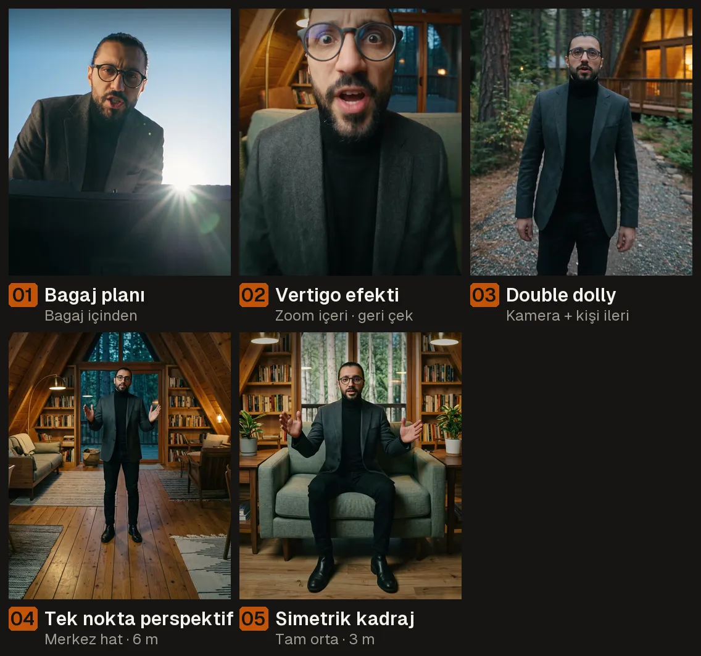
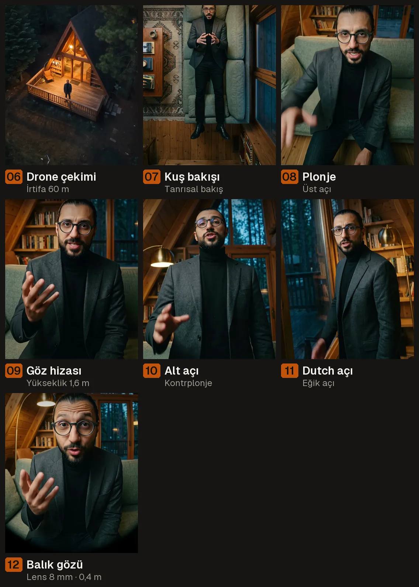
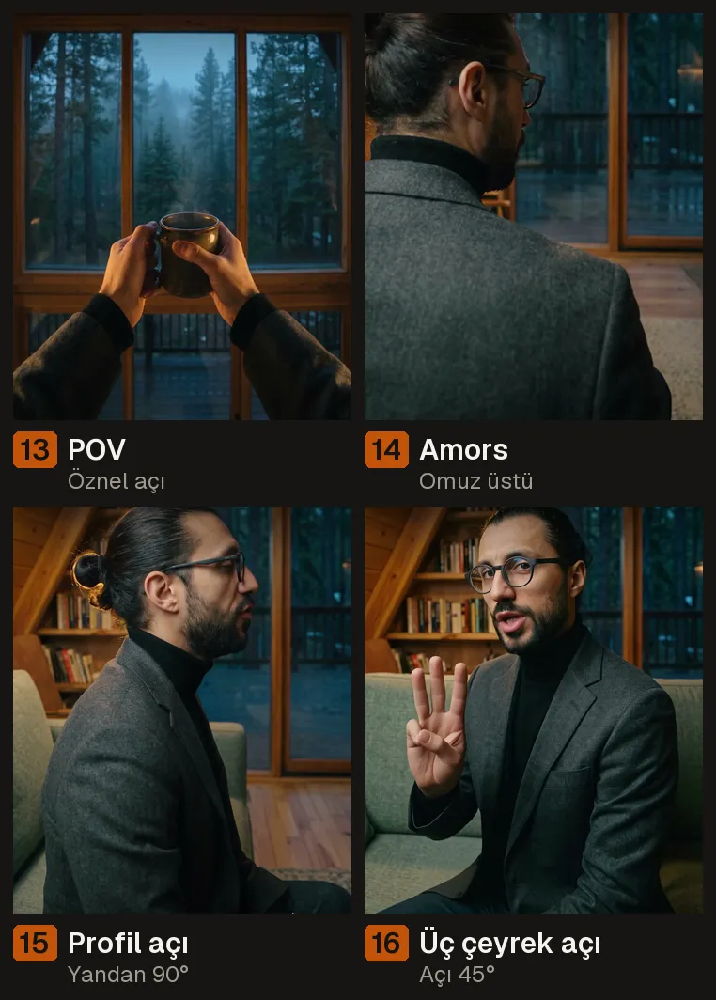
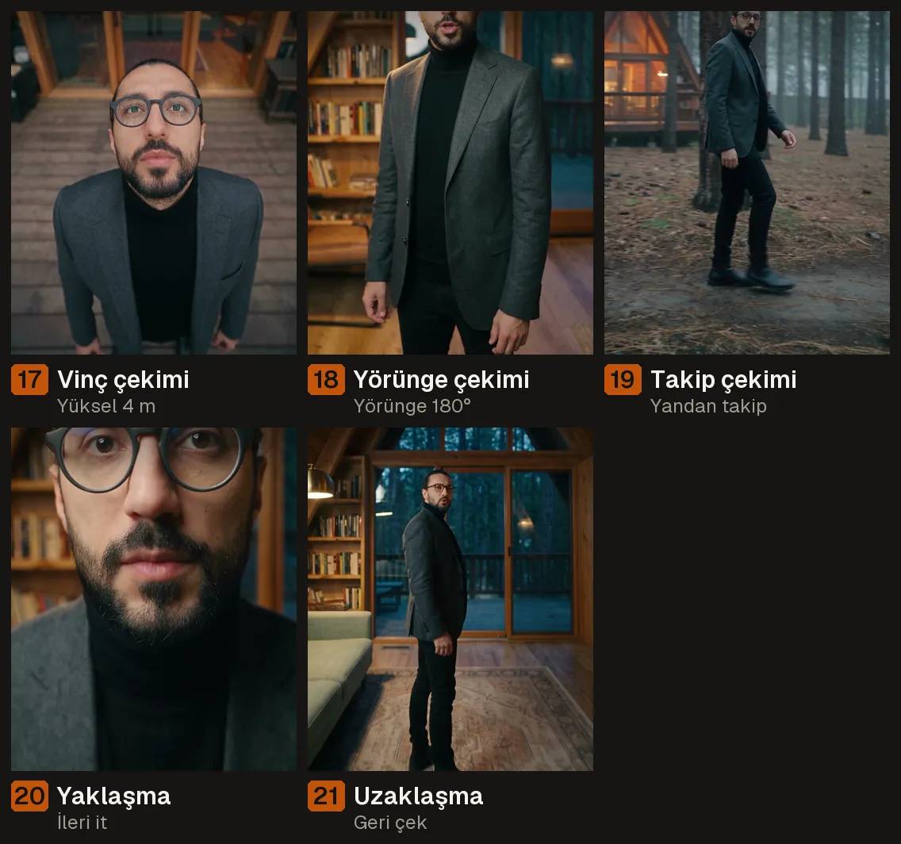
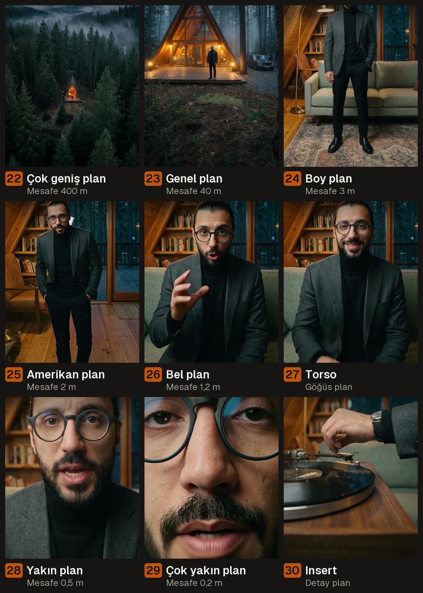

## Ne bu?

[Reels'te](https://www.instagram.com/reel/DgSpT8ChYb7/) 30 kamera açısını aynı mekânda, aynı kişiyle gösterdik: ormandaki ahşap bir ev ve koyu takım elbiseli bir adam. Her karede açının adı ve kameranın nerede durduğu yazıyordu. Bu sayfada her açının ne anlattığını, ne zaman kullanılacağını, telefonla nasıl çekileceğini ve yapay zekâya nasıl yazılacağını bulacaksınız.

**PDF olarak indirin:** [30 kamera açısı rehberi (PDF)](/indir/kamera-acilari.pdf)

## Yapay zekâyla nasıl kullanılır?

- **Sabit açılar** (hareket etmeyen kamera): [ChatGPT](https://chatgpt.com)'de ya da [Google Flow](https://flow.google.com)'da görsel olarak üretebilirsiniz.
- **Hareketli açılar** (aşağıda 🎥 işaretli olanlar): kamera hareket ettiği için video gerekir. Bunları Google Flow'da video olarak üretin. Flow, Gemini aboneliğiyle kullanılıyor.
- İstemlerde videodaki sahneyi kullandık: koyu takım elbiseli bir adam ve ormanda ahşap bir ev. Kişiyi ve mekânı kendinize göre değiştirin; **açıyı anlatan ilk kısmı aynen bırakın.**
- Açıların İngilizce adlarını da yazdık. İstemi Türkçe yazsanız bile açının adını İngilizce bırakın; "low angle", "over-the-shoulder" gibi terimler sinema dilinde yerleşik.
- Aynı sahneyi birkaç açıdan üretip art arda koyarsanız tek bir çekimden kısa bir sahne kurmuş olursunuz.

## İmza yönetmen açıları

Belli yönetmenlerle anılan, görünce "bu kimin filmi?" dedirten açılar. Videonun ilk beş açısı bunlar.



### 1. Bagaj planı

*İngilizce: Trunk shot · Videoda kamera: Bagaj içinden*

**Yönetmen:** Quentin Tarantino: Rezervuar Köpekleri (1992), Ucuz Roman (1994)

Kamera bir arabanın bagajının içinde, yukarı bakıyor; kişiler bagajı açıp içeri eğiliyor. İzleyiciyi bagajdaki kişinin ya da nesnenin yerine koyar, kişileri alttan ve tehditkâr gösterir.

**Ne zaman:** Gerilim ve sürpriz anı. Bir kutuyu ya da çantayı açtığınız ürün videolarında da eğlenceli durur.

**Telefonla:** Telefonu bagajın tabanına ekranı yukarı bakacak şekilde koyun, geniş açı (0,5×) lensi seçin.

```text
Low-angle trunk shot from inside a car trunk looking up: a man in a dark suit and black turtleneck leans over the open trunk and looks down into the camera, bright sky behind him, the trunk lid frames the shot, cinematic.
```

### 2. Vertigo efekti 🎥

*İngilizce: Dolly zoom · Videoda kamera: Zoom içeri · geri çek*

**Yönetmen:** Alfred Hitchcock: Vertigo (1958). Spielberg'in Jaws'ındaki (1975) plaj sahnesiyle de bilinir.

Kamera geri çekilirken lens yakınlaşıyor. Kişi kadrajda aynı boyda kalıyor ama arkasındaki mekân uzayıp gidiyor. Baş dönmesi ve şok hissi verir.

**Ne zaman:** Bir şeyi birden fark etme, korku, "eyvah" anı. Kısa tutun.

**Telefonla:** Telefonla zor: geriye yürürken aynı anda yakınlaştırmanız gerekir. Önce yapay zekâyla denemek daha kolay.

**Not:** Modeller bu hareketi her seferinde doğru yapmayabilir; birkaç deneme gerekebilir.

```text
Dolly zoom (vertigo effect): the camera pulls back while zooming in, a man in a dark suit and black turtleneck stays the same size in the frame while the cabin interior behind him stretches away, he looks shocked, cinematic.
```

### 3. Double dolly 🎥

*İngilizce: Double dolly · Videoda kamera: Kamera + kişi ileri*

**Yönetmen:** Spike Lee: Malcolm X (1992) ve başka pek çok filmi

Kişi de kamerayla birlikte tekerlekli bir platformun üstünde; ikisi aynı hızda ilerliyor. Kişi yürümüyor, süzülüyormuş gibi görünür. Rüya ya da kendinden geçmiş bir hal.

**Ne zaman:** Kişinin bir karara ya da olaya doğru "çekildiği" an; gerçeküstü geçişler.

**Telefonla:** Kişiyi tekerlekli bir sandalyeye ya da kaykaya koyup itin; siz de aynı hızda geri geri yürüyerek çekin.

```text
Double dolly shot: a man in a dark suit and black turtleneck glides forward along a gravel path in a pine forest without moving his legs, his body perfectly still, the camera moves back at the same speed in front of him, the trees slide past, dreamlike, cinematic.
```

### 4. Tek nokta perspektif

*İngilizce: One-point perspective · Videoda kamera: Merkez hat · 6 m*

**Yönetmen:** Stanley Kubrick: Cinnet (1980), 2001: Bir Uzay Destanı (1968)

Zeminin, tavanın, rafların bütün çizgileri kadrajın ortasındaki tek bir noktada birleşiyor; kişi o noktanın önünde duruyor. Düzenli, soğuk, biraz tedirgin edici.

**Ne zaman:** Koridor, yol, simetrik bir oda. Güç, yalnızlık, kontrol duygusu.

**Telefonla:** Odanın tam ortasına geçin, telefonu dik ve düz tutun, ızgara çizgilerini açın. Çizgiler ekranın ortasında birleşmeli.

```text
One-point perspective wide shot from the center line of a wooden A-frame cabin interior: the floor boards, bookshelves and ceiling beams all converge to a single vanishing point behind a man in a dark suit and black turtleneck standing in the middle, symmetrical, Kubrick style, cinematic.
```

### 5. Simetrik kadraj

*İngilizce: Symmetrical framing · Videoda kamera: Tam orta · 3 m*

**Yönetmen:** Wes Anderson: Büyük Budapeşte Oteli (2014)

Kadrajın sağı ve solu birbirinin aynası; kişi tam ortada, kameraya dönük. Düzenli, masalsı, biraz da komik.

**Ne zaman:** Kendinizi ya da bir ürünü tanıtırken; "her şey yerli yerinde" duygusu.

**Telefonla:** Izgarayı açın, kişiyi ortadaki dikey çizgiye koyun, iki yandaki eşyaları eşitleyin.

```text
Perfectly symmetrical frame: a man in a dark suit and black turtleneck sits in the exact center of an armchair facing the camera, identical bookshelves, lamps and plants on both sides, flat frontal composition, Wes Anderson style, warm colors.
```

## Kameranın yüksekliği ve eğimi

Kamera ne kadar yukarıda ya da aşağıda, kişiye hangi açıyla bakıyor? İzleyicinin kişiyi nasıl gördüğünü en çok bu belirler.



### 6. Drone çekimi

*İngilizce: Aerial / drone shot · Videoda kamera: İrtifa 60 m*

Havadan, yüksekten ve uzaktan bakış. Mekânı ve kişinin o mekândaki yerini bir anda anlatır.

**Ne zaman:** Açılış, mekân tanıtımı, bölüm geçişi.

**Telefonla:** Telefonla olmaz, drone gerekir. Uçurmadan önce bulunduğunuz yerdeki kuralları kontrol edin.

```text
Aerial drone shot from about 60 meters high at dusk: a glowing wooden A-frame cabin in a dark pine forest, the tiny figure of a man in a dark suit and black turtleneck standing on the deck, cinematic.
```

### 7. Kuş bakışı (Tanrısal bakış)

*İngilizce: Bird's-eye view / top-down · Videoda kamera: Tepeden 90°*

Kamera tam tepede, dik aşağı bakıyor. Kişi bir haritanın ya da desenin parçası gibi görünür; izleyici olayı yukarıdan, dışarıdan izler.

**Ne zaman:** Masa üstü, yemek, uzanmış kişi; desen ve düzen göstermek.

**Telefonla:** Telefonu bir sopaya bağlayıp ya da bir merdivenin üstünden dik aşağı tutun. En kolayı masada tepeden çekim.

```text
Top-down overhead shot, the camera directly above at 90 degrees: a man in a dark suit and black turtleneck sits on a sage green sofa and looks up at the camera, patterned rug and wooden floor around him, cinematic.
```

### 8. Plonje (Üst açı)

*İngilizce: High angle · Videoda kamera: Eğim 35° aşağı*

Kamera göz hizasının üstünde, kişiye aşağı doğru bakıyor. Kişiyi küçük, savunmasız ya da yalnız gösterir.

**Ne zaman:** Kişi zor durumdayken, kararsızken; izleyicinin ona yukarıdan baktığı anlar.

**Telefonla:** Telefonu başınızın üstüne kaldırıp kişiye doğru aşağı eğin.

```text
High-angle shot, the camera above eye level tilted about 35 degrees down at a man in a dark suit and black turtleneck sitting on a sofa, he looks up at the camera and appears small, cinematic.
```

### 9. Göz hizası

*İngilizce: Eye level · Videoda kamera: Yükseklik 1,6 m*

Kamera kişinin göz hizasında. En doğal, en tarafsız açı; izleyici karşısında oturup onu dinliyormuş gibi olur.

**Ne zaman:** Konuşmalı video, röportaj, anlatım. Konuşmalı Reels'lerin çoğu bu açıyla çekilir.

**Telefonla:** Telefonu tripoda koyup lensi gözlerinizle aynı yüksekliğe getirin.

```text
Eye-level medium shot, the camera at his eye height, about 1.6 meters: a man in a dark suit and black turtleneck talks to the camera in a cozy cabin living room with bookshelves, natural light, cinematic.
```

### 10. Alt açı (Kontrplonje)

*İngilizce: Low angle · Videoda kamera: Eğim 30° yukarı*

Kamera aşağıda, kişiye yukarı doğru bakıyor. Kişiyi güçlü, büyük ve kendinden emin gösterir.

**Ne zaman:** Lider, kahraman, iddialı bir cümle.

**Telefonla:** Telefonu bel ya da diz hizasında tutup yukarı eğin.

```text
Low-angle shot, the camera below a man in a dark suit and black turtleneck tilted about 30 degrees up, he looks powerful and confident, the wooden ceiling of the cabin behind him, cinematic.
```

### 11. Dutch açı (Eğik açı)

*İngilizce: Dutch angle · Videoda kamera: Yatış 25°*

Kamera yana yatırılmış, ufuk çizgisi eğik. Huzursuzluk, kafa karışıklığı, bir şeylerin ters gittiği hissi.

**Ne zaman:** Gerilim, kaos, rüya. Kısa kullanın; uzun sürerse izleyiciyi yorar.

**Telefonla:** Telefonu 15–25 derece yana yatırın.

```text
Dutch angle, the camera tilted about 25 degrees sideways, the horizon and bookshelves slanted: a man in a dark suit and black turtleneck stands by a large window and looks uneasy, cinematic.
```

### 12. Balık gözü

*İngilizce: Fisheye lens · Videoda kamera: Lens 8 mm · 0,4 m*

Çok geniş, kenarları büken bir lens, kameraya çok yakın. Yüz ortada büyür, çevre kavislenir. Komik ve enerjik.

**Ne zaman:** Eğlenceli içerik, abartılı tepki, hızlı bir giriş.

**Telefonla:** 0,5× lensi seçip telefonu yüzünüze 30–40 cm yaklaştırın. Tam balık gözü için telefona takılan lens gerekir.

```text
Fisheye lens shot, 8mm, the camera about 40 centimeters from the face of a man in a dark suit and black turtleneck, strong barrel distortion, curved walls and bookshelves around him, he gestures toward the lens, playful, cinematic.
```

## Kameranın baktığı yön

Kişiye önden mi, yandan mı, onun gözünden mi bakıyoruz?



### 13. POV (Öznel açı)

*İngilizce: POV / first person · Videoda kamera: Birinci şahıs*

Kamera kişinin gözü; izleyici onun gördüğünü görür: kendi ellerini, tuttuğu şeyi.

**Ne zaman:** Tarif, el işi, deneyim anlatımı, "benimle bir gün" videoları.

**Telefonla:** Telefonu göğsünüze sabitleyin ya da gözünüzün hemen altında tutun; ellerinizi kadraja sokun.

```text
First-person POV shot through the eyes of a man: his hands hold a warm cup of coffee in front of a large window overlooking a misty pine forest, the sleeves of his dark suit visible, cinematic.
```

### 14. Amors (Omuz üstü)

*İngilizce: Over-the-shoulder · Videoda kamera: Omuz üstü*

Kamera kişinin omzunun arkasından, onun baktığı yere bakıyor. Omuz kadrajın kenarında bulanık kalır. İzleyici sahnenin içine girer.

**Ne zaman:** İki kişilik konuşma, röportaj; kişinin neye baktığını göstermek.

**Telefonla:** Telefonu kişinin omzunun biraz arkasına ve yanına koyun; omzu ve başının bir kısmı kadrajın kenarında kalsın.

```text
Over-the-shoulder shot from behind a man in a dark suit and black turtleneck: his shoulder and hair blurred in the foreground, looking out at a large window with a misty pine forest, shallow depth of field, cinematic.
```

### 15. Profil açı

*İngilizce: Profile shot · Videoda kamera: Yandan 90°*

Kişi kameraya tam yandan görünüyor. Mesafeli ve düşünceli; izleyici izliyor ama göz teması yok.

**Ne zaman:** Düşünme anı, iki kişinin karşılıklı konuşması, siluet.

**Telefonla:** Kişinin tam yanına geçin; yüzünün baktığı tarafta kadrajda boşluk bırakın.

```text
Side profile shot at 90 degrees: a man in a dark suit and black turtleneck sits on a sofa seen exactly from the side, looking ahead, bookshelves behind him, soft window light, cinematic.
```

### 16. Üç çeyrek açı

*İngilizce: Three-quarter angle · Videoda kamera: Açı 45°*

Kişi kameraya 45 derece dönük; yüz de görünür, derinlik de. Röportajların klasik açısı.

**Ne zaman:** Röportaj, anlatım; yüze hacim vermek.

**Telefonla:** Kişi kameraya değil, kameranın biraz yanında duran birine baksın.

```text
Three-quarter angle: a man in a dark suit and black turtleneck turned about 45 degrees from the camera, talking to someone just off camera, warm interview lighting, bookshelves softly blurred behind him, cinematic.
```

## Kamera hareketleri

Bu açılarda kamera yerinde durmuyor. Yapay zekâyla üretecekseniz video gerekir.



### 17. Vinç çekimi 🎥

*İngilizce: Crane shot · Videoda kamera: Yüksel 4 m*

Kamera yerden yükseliyor, kişiden yukarı ve uzağa çıkıyor. Görkem; açılış ya da kapanış duygusu.

**Ne zaman:** Sahnenin başı ya da sonu, büyük bir an.

**Telefonla:** Telefonu bir sopa ya da selfie çubuğuyla aşağıdan yukarı kaldırın; yavaş ve sabit.

```text
Crane shot: the camera rises smoothly from eye level to about 4 meters while tilting down, revealing a man in a dark suit and black turtleneck standing in the cabin living room from above, cinematic.
```

### 18. Yörünge çekimi 🎥

*İngilizce: Orbit / arc shot · Videoda kamera: Yörünge 180°*

Kamera kişinin etrafında yay çizerek dönüyor. Kişiyi merkeze koyar, anı önemli kılar.

**Ne zaman:** Kişiyi ya da bir ürünü tanıtmak, "işte o an" vurgusu.

**Telefonla:** Kişiden aynı uzaklıkta kalarak etrafında yürüyün. Gimbal işi kolaylaştırır.

```text
Orbit shot: the camera circles 180 degrees around a man in a dark suit and black turtleneck standing in the cabin living room, keeping him centered, the background rotating behind him, smooth, cinematic.
```

### 19. Takip çekimi 🎥

*İngilizce: Tracking shot · Videoda kamera: Yandan takip*

Kamera yürüyen kişinin yanında, aynı hızda ilerliyor. İzleyici yolculuğa eşlik eder.

**Ne zaman:** Yürürken konuşma, yolculuk, bir yerden bir yere geçiş.

**Telefonla:** Kişinin yanında aynı hızda yürüyün; telefonu iki elle tutun, dizlerinizi hafif bükün.

```text
Side tracking shot: the camera moves alongside a man in a dark suit and black turtleneck as he walks through a misty pine forest at the same speed, he stays in the center of the frame, tree trunks pass in the foreground, cinematic.
```

### 20. Yaklaşma 🎥

*İngilizce: Push in · Videoda kamera: İleri it*

Kamera kişiye doğru yavaşça ilerliyor. Dikkati toplar; gerilimi ya da duyguyu artırır.

**Ne zaman:** Önemli bir cümle, bir sır, karar anı.

**Telefonla:** Telefonu yavaşça kişiye doğru ilerletin. Yakınlaştırma (zoom) yerine kendiniz yaklaşın.

```text
Slow push-in: the camera moves slowly toward the face of a man in a dark suit and black turtleneck as he speaks, from a medium shot to a close-up, the background softly blurring, cinematic.
```

### 21. Uzaklaşma 🎥

*İngilizce: Pull out · Videoda kamera: Geri çek*

Kamera kişiden geri çekiliyor, çevresini açıyor. Yalnızlık, bitiş ya da büyük resmi gösterme.

**Ne zaman:** Kapanış; "aslında nerede olduğumuzu görün" anı.

**Telefonla:** Telefonu kişiye dönük tutup geriye doğru yavaşça yürüyün.

```text
Slow pull-out: the camera moves back away from a man in a dark suit and black turtleneck standing by the window, revealing the whole cabin living room around him, cinematic.
```

## Plan ölçekleri

Kişi kadraja ne kadar sığıyor? Uzaktan yakına doğru sıralı.



### 22. Çok geniş plan

*İngilizce: Extreme wide shot · Videoda kamera: Mesafe 400 m*

Mekân her şey; kişi çok küçük ya da hiç seçilmiyor.

**Ne zaman:** Açılış, mekânı tanıtmak, yalnızlık.

**Telefonla:** Yüksek ya da uzak bir noktaya çıkın; kişi kadrajda bir nokta kadar kalsın.

```text
Extreme wide shot of a misty pine forest valley at dusk, a tiny glowing wooden A-frame cabin in the middle of the trees, no person visible, cinematic.
```

### 23. Genel plan

*İngilizce: Wide shot · Videoda kamera: Mesafe 40 m*

Kişi ve mekân birlikte; kişi seçiliyor ama mekân baskın. Nerede olduğumuzu anlatır.

**Ne zaman:** Sahneye giriş, kişiyi mekânla tanıtmak.

**Telefonla:** Kişiden uzaklaşın; binanın ya da mekânın tamamı kadraja girsin.

```text
Wide shot from about 40 meters: a man in a dark suit and black turtleneck stands on the deck of a glowing wooden A-frame cabin in a pine forest at dusk, the whole cabin visible, cinematic.
```

### 24. Boy plan

*İngilizce: Full shot · Videoda kamera: Mesafe 3 m*

Kişi baştan ayağa kadrajda. Beden dili, kıyafet ve duruş görünür.

**Ne zaman:** Kıyafet, dans, hareket; kişiyi tanıtmak.

**Telefonla:** Kişiden 3 metre kadar uzaklaşın; baş ve ayaklar kadrajda kalsın.

```text
Full shot from about 3 meters: a man in a dark suit and black turtleneck seen from head to toe, standing in a cabin living room, sofa and patterned rug around him, cinematic.
```

### 25. Amerikan plan

*İngilizce: Cowboy shot / medium full shot · Videoda kamera: Mesafe 2 m*

Kişi dizlerden yukarı. Adını western filmlerinden alır: belindeki tabanca kadraja girsin diye.

**Ne zaman:** Ayakta konuşma, iki üç kişilik sahne.

**Telefonla:** Kadrajı dizlerin hemen üstünden kesin.

```text
Medium full shot (cowboy shot): a man in a dark suit and black turtleneck framed from the knees up, hands in his pockets, standing in front of bookshelves, cinematic.
```

### 26. Bel plan

*İngilizce: Medium shot · Videoda kamera: Mesafe 1,2 m*

Belden yukarı. Hem yüz ifadesi hem el hareketleri görünür. Konuşmalı videoların en yaygın plan ölçüsü.

**Ne zaman:** Anlatım, eğitim videosu, konuşma.

**Telefonla:** Kadrajı belin biraz altından kesin; ellerinize yer bırakın.

```text
Medium shot: a man in a dark suit and black turtleneck framed from the waist up, talking and gesturing with his hands, cozy cabin interior behind him, cinematic.
```

### 27. Torso (Göğüs plan)

*İngilizce: Medium close-up · Videoda kamera: Mesafe 0,8 m*

Göğüsten yukarı. Yüz öne çıkar, eller az görünür; daha samimi.

**Ne zaman:** Kameraya doğrudan konuşma, kişisel bir anlatım.

**Telefonla:** Kadrajı göğsün ortasından kesin; gözler üst üçte birlik çizgide olsun.

```text
Medium close-up: a man in a dark suit and black turtleneck framed from the chest up, speaking to the camera, shallow depth of field, cinematic.
```

### 28. Yakın plan

*İngilizce: Close-up · Videoda kamera: Mesafe 0,5 m*

Omuzlardan yukarı; yüz kadrajı dolduruyor. Duygu ve ifade öne çıkar.

**Ne zaman:** Önemli bir cümle, duygusal bir an.

**Telefonla:** Telefonu yüze yarım metre kadar yaklaştırın; arka planı sade tutun.

```text
Close-up of the face and shoulders of a man in a dark suit and black turtleneck, he speaks with emotion, soft light, blurred background, cinematic.
```

### 29. Çok yakın plan

*İngilizce: Extreme close-up · Videoda kamera: Mesafe 0,2 m*

Yüzün bir bölümü: gözler, ağız. Yoğun duygu ve gerilim. Kısa kullanın.

**Ne zaman:** Doruk anı, tepki, gerilim.

**Telefonla:** Telefon bu kadar yakında net çekemezse biraz uzaklaşıp yakınlaştırın ya da makro modunu açın.

```text
Extreme close-up of a bearded man's eyes behind round glasses, filling the frame, skin texture visible, cinematic.
```

### 30. Insert (Detay plan)

*İngilizce: Insert shot · Videoda kamera: Detay · 0,3 m*

Kişi değil, bir nesne ya da ayrıntı: pikaba iğneyi koyan el, saat, kalem. Hikâyeye bilgi ve doku katar; kurgu geçişlerinde de işe yarar.

**Ne zaman:** Ürün, el işi, sahneler arası geçiş.

**Telefonla:** Nesneye 20–30 cm yaklaşın, arka planı sade tutun.

```text
Insert shot, detail close-up of a hand placing the needle on a spinning vinyl record on a wooden turntable, warm light, shallow depth of field.
```

## Bilmeniz gerekenler

- Videoda kameranın konumunu gösteren etiketler (mesafe, yükseklik, eğim) yaklaşık değerler; açıyı anlamanız için. Kendi çekiminizde kişinin boyuna ve mekâna göre değişir.
- Açı adları kaynaktan kaynağa değişebiliyor. Örneğin "Amerikan plan" İngilizcede "cowboy shot", "Amors" ise Fransızca "amorce"tan geliyor ve İngilizcede "over-the-shoulder" deniyor.
- Hareketli açıları yapay zekâ her seferinde istediğiniz gibi yapmayabilir. Hareketi istemin başına yazın ve birkaç kez deneyin.
- Bir videoda hepsini kullanmak zorunda değilsiniz. Konuşmalı bir video için göz hizası, bel plan ve yakın plan çoğu zaman yeterli; arada bir insert ya da yaklaşma tempo katar.
